# Class Diagram

UML class diagram of `nutrition-core`, generated from its source (D22). GitHub and most Markdown viewers render the Mermaid block below as a diagram.

## Notation

- One class per struct or enum; enums carry `<<enumeration>>` and list their variants, with the payload in brackets (`Known [MeasuredAmount]`).
- `<<module>>` classes hold the free functions and constants of a module; `%% path` comments give the module of the classes that follow.
- Visibility: `+` `pub`, `~` `pub(crate)`, `-` private. Fields are shown at every visibility; functions and constants only when `pub` or `pub(crate)`.
- `$` marks an associated function (no `self`) or an associated constant. `self` is not listed in the arguments.
- Types use their last path segment, with lifetimes removed; generics are written between `~` (`Vec~RecipeItem~` is `Vec<RecipeItem>`). The unit type `()` is written `unit` and tuples `tuple~A, B~`, because Mermaid reads a `)` inside a member as the end of the argument list.
- `A *-- "n" B : field` means a field of `A` holds `n` values of `B` (`1`, `0..1` for `Option`, `*` for collections).
- `A ..|> Trait` means `A` implements the trait.

## Updating

Do not edit the generated block by hand. After changing the types or signatures of `nutrition-core`, run:

```sh
cargo xtask uml
```

`cargo test --workspace` fails while the diagram does not match the source (test `class_diagram_matches_the_code`); `cargo xtask uml --check` runs the same check alone.

## Diagram

```mermaid
classDiagram
    %% calculations::recipe_nutrients
    class IngredientLine {
        +position: usize
        +food_id: FoodId
        +food_name: String
        +state: State
        +quantity: Grams
        +shared_composition: bool
    }
    class NutrientTotal {
        -nutrient: Nutrient
        -sum_of_products: i128
        -total: Amount
        -per_serving: Amount
        -unknown_items: Vec~usize~
        +nutrient() &Nutrient
        +total() Amount
        +per_serving() Amount
        +unknown_items() &[usize]
    }
    class RecipeComposition {
        -recipe_name: String
        -servings: Servings
        -cooked_weight: Option~Grams~
        -ingredients: Vec~IngredientLine~
        -nutrients: Vec~NutrientTotal~
        +recipe_name() &str
        +servings() Servings
        +ingredients() &[IngredientLine]
        +nutrients() &[NutrientTotal]
        +nutrient(code: &str) Option~&NutrientTotal~
        +shared_composition_items() Vec~usize~
        +portion(nutrient_code: &str, portion: Grams) Result~Amount, Error~
    }
    class recipe_nutrients {
        <<module>>
        +calculate_recipe(recipe: &Recipe, foods: &FoodCatalog, nutrients: &[Nutrient])$ Result~RecipeComposition, Error~
    }
    %% domain::food
    class FoodId {
        +0: i64
    }
    class State {
        <<enumeration>>
        Raw
        Cooked
    }
    class Composition {
        -reference_quantity: Grams
        -values: HashMap~String, NutrientValue~
        +new(reference_quantity: Grams)$ Composition
        +per_100g()$ Composition
        +with(nutrient_code: impl Into~String~, value: NutrientValue) Composition
        +set(nutrient_code: impl Into~String~, value: NutrientValue)
        +value(nutrient_code: &str) NutrientValue
        +values() impl Iterator~Item = tuple~&str, NutrientValue~~
        +reference_quantity() Grams
    }
    class Compositions {
        <<enumeration>>
        Shared [Composition]
        Distinct [raw: Composition, cooked: Composition]
    }
    class Food {
        -id: FoodId
        -name: String
        -compositions: Compositions
        +new(id: FoodId, name: impl Into~String~, compositions: Compositions)$ Food
        +id() FoodId
        +name() &str
        +compositions() &Compositions
        +composition(state: State) &Composition
        +is_shared() bool
    }
    class FoodCatalog {
        -foods: HashMap~FoodId, Food~
        +new()$ FoodCatalog
        +insert(food: Food) Result~unit, Error~
        +get(id: FoodId) Option~&Food~
        +len() usize
        +is_empty() bool
    }
    %% domain::nutrient
    class Nutrient {
        -code: String
        -name: String
        -unit: Unit
        +new(code: impl Into~String~, name: impl Into~String~, unit: Unit)$ Nutrient
        +code() &str
        +name() &str
        +unit() Unit
    }
    class MeasuredAmount {
        -0: i64
        +milli() i64
    }
    class NutrientValue {
        <<enumeration>>
        Known [MeasuredAmount]
        Zero
        Trace
        BelowLimit [limit: MeasuredAmount]
        Unknown
        +known(milli: i64)$ Result~NutrientValue, Error~
        +below_limit(limit: i64)$ Result~NutrientValue, Error~
        ~contribution() i64
    }
    class nutrient {
        <<module>>
        +initial_nutrients()$ Vec~Nutrient~
    }
    %% domain::quantity
    class Grams {
        -0: u32
        +HUNDRED: Grams$
        +new(grams: i64)$ Result~Grams, Error~
        +get() u32
    }
    class Unit {
        <<enumeration>>
        Gram
        Milligram
        Microgram
        Kilojoule
        Kilocalorie
        +symbol() &str
        +display_decimals() u32
    }
    class Amount {
        -0: i64
        +ZERO: Amount$
        +from_milli(milli: i64)$ Amount
        +milli() i64
        +display(unit: Unit) AmountDisplay
    }
    class AmountDisplay {
        -amount: Amount
        -unit: Unit
    }
    class quantity {
        <<module>>
        +AMOUNT_DECIMALS: u32
        ~div_round(dividend: i128, divisor: i128)$ i128
    }
    %% domain::recipe
    class Servings {
        -0: u32
        +new(servings: i64)$ Result~Servings, Error~
        +get() u32
    }
    class RecipeItem {
        +food_id: FoodId
        +state: State
        +quantity: Grams
    }
    class Recipe {
        -name: String
        -servings: Servings
        -cooked_weight: Option~Grams~
        -items: Vec~RecipeItem~
        +new(name: impl Into~String~, servings: Servings)$ Recipe
        +name() &str
        +servings() Servings
        +set_servings(servings: Servings)
        +cooked_weight() Option~Grams~
        +set_cooked_weight(cooked_weight: Option~Grams~)
        +items() &[RecipeItem]
        +add_ingredient(food_id: FoodId, state: State, quantity: Grams) usize
        +remove_ingredient(index: usize) Result~RecipeItem, Error~
    }
    %% error
    class Error {
        <<enumeration>>
        InvalidQuantity [grams: i64]
        InvalidServings [servings: i64]
        NegativeAmount [milli: i64]
        FoodNotFound [food_id: FoodId]
        DuplicateFood [food_id: FoodId]
        UnsupportedReferenceQuantity [food_id: FoodId, grams: u32]
        EmptyRecipe
        IngredientIndexOutOfRange [index: usize, len: usize]
        CookedWeightUnknown
        DuplicateNutrient [code: String]
        NutrientNotCalculated [code: String]
        Overflow
    }
    class Display {
        <<trait>>
    }
    IngredientLine *-- "1" FoodId : food_id
    IngredientLine *-- "1" State : state
    IngredientLine *-- "1" Grams : quantity
    NutrientTotal *-- "1" Nutrient : nutrient
    NutrientTotal *-- "1" Amount : total
    NutrientTotal *-- "1" Amount : per_serving
    RecipeComposition *-- "1" Servings : servings
    RecipeComposition *-- "0..1" Grams : cooked_weight
    RecipeComposition *-- "*" IngredientLine : ingredients
    RecipeComposition *-- "*" NutrientTotal : nutrients
    Composition *-- "1" Grams : reference_quantity
    Composition *-- "*" NutrientValue : values
    Compositions *-- "1" Composition : Shared
    Compositions *-- "1" Composition : Distinct.raw
    Compositions *-- "1" Composition : Distinct.cooked
    Food *-- "1" FoodId : id
    Food *-- "1" Compositions : compositions
    FoodCatalog *-- "*" FoodId : foods
    FoodCatalog *-- "*" Food : foods
    Nutrient *-- "1" Unit : unit
    NutrientValue *-- "1" MeasuredAmount : Known
    NutrientValue *-- "1" MeasuredAmount : BelowLimit.limit
    AmountDisplay *-- "1" Amount : amount
    AmountDisplay *-- "1" Unit : unit
    RecipeItem *-- "1" FoodId : food_id
    RecipeItem *-- "1" State : state
    RecipeItem *-- "1" Grams : quantity
    Recipe *-- "1" Servings : servings
    Recipe *-- "0..1" Grams : cooked_weight
    Recipe *-- "*" RecipeItem : items
    Error *-- "1" FoodId : FoodNotFound.food_id
    Error *-- "1" FoodId : DuplicateFood.food_id
    Error *-- "1" FoodId : UnsupportedReferenceQuantity.food_id
    RecipeComposition ..|> Display
    FoodId ..|> Display
    State ..|> Display
    Grams ..|> Display
    AmountDisplay ..|> Display
```

<!-- BEGIN GENERATED by `cargo xtask uml`; do not edit by hand -->

<!-- END GENERATED -->
